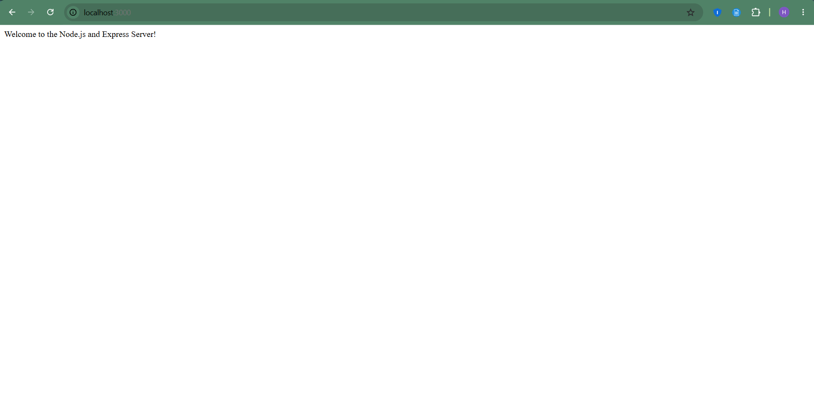
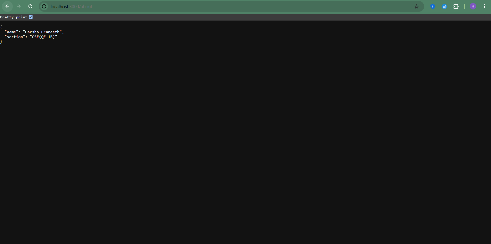
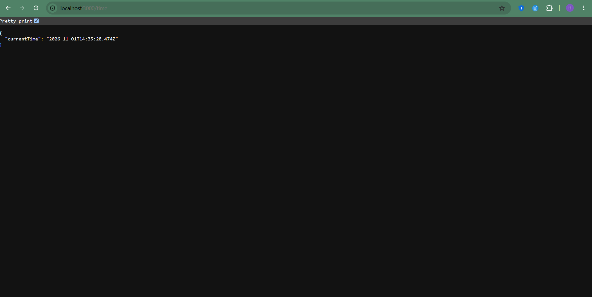
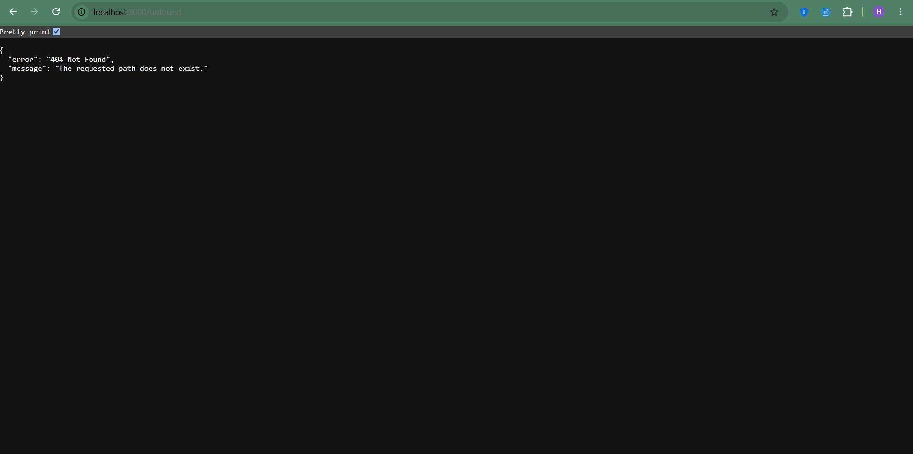

# Lab 1: Node.js and Express Server

## Student Details

- **Name:** YOUR NAME
- **Registration Number:** YOUR REGISTRATION NUMBER
- **Section:** YOUR SECTION

## Live Deployment

- **URL:** Add your deployed server URL here.
- **Status:** Pending deployment.

## Project Description

This project demonstrates the fundamentals of Node.js and Express.js by implementing a web server with multiple HTTP endpoints.

## Technologies Used

- Node.js
- Express.js
- JavaScript
- Git and GitHub

## How to Install and Run

### Prerequisites

- Node.js and npm installed.

### Installation

1. Clone the repository.
2. Navigate to the lab-01 folder.
3. Install the dependencies.
4. Start the server.

```bash
git clone YOUR_GITHUB_REPOSITORY_URL
cd YOUR_REPOSITORY_NAME/lab-01
npm install
node index.js
```

The server runs on port 3000 by default, if configured that way in the code.

## API Endpoints

| Method | Endpoint         | Description                                 |
| ------ | ---------------- | ------------------------------------------- |
| GET    | `/`              | Displays the welcome message.               |
| GET    | `/about`         | Returns student information in JSON format. |
| GET    | `/time`          | Returns the current date and time.          |
| GET    | Any unknown path | Returns a 404 response.                     |

## Screenshots

### Home Endpoint



### About Endpoint



### Time Endpoint



### 404 Error



## Problems Faced and Solutions

Document any problems encountered while creating the server and explain how you solved them.
